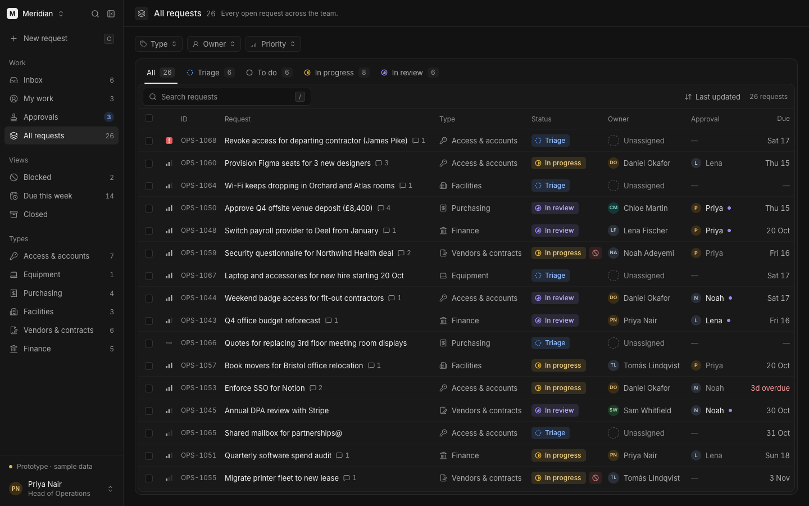
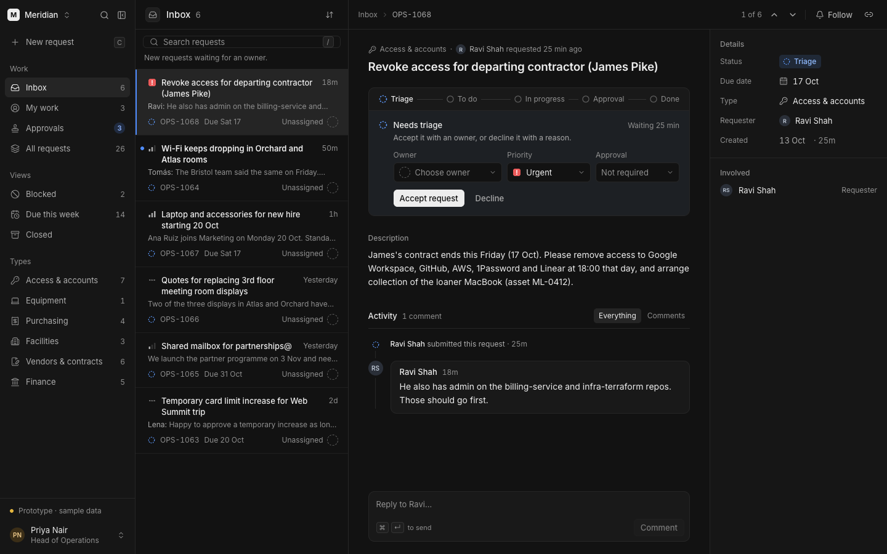
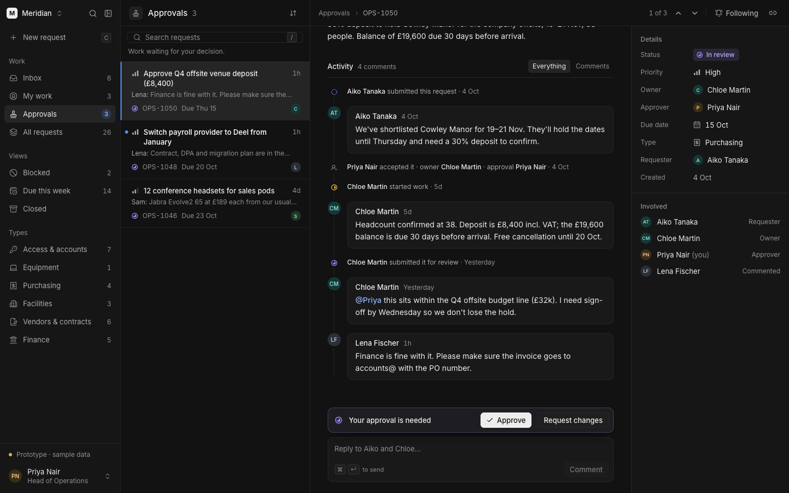
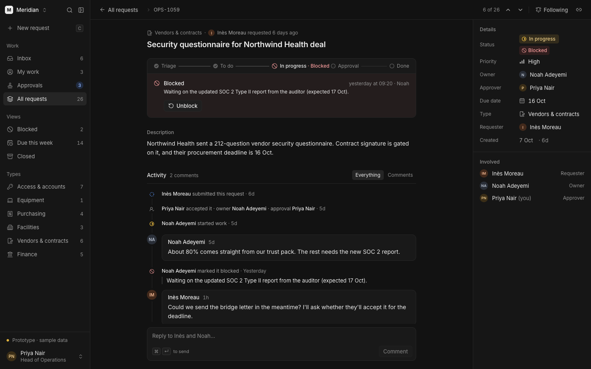

# Meridian — Team Ops

A request workspace for small operations teams. Triage incoming requests, give each one an owner, get sign-off where it's needed, and keep a complete history of what happened.



> **An interactive frontend prototype with fictional sample data.** Everything runs in the browser. There is no persistent storage (a reload resets the data), no authentication, no production backend and no real multi-user collaboration. You can switch which team member you are acting as from the account menu to see how permissions change.

## What it does

**A real workflow, not a mock-up.** Requests move through Triage → To do → In progress → In review → Done (or Declined), with Blocked as a flag that records why and since when. Every state change goes through one framework-free rules module, which decides whether the action is allowed and records it in the request's history:

- accepting a request requires an owner; only the owner can start, submit or complete the work
- only the named approver can approve or request changes, and the approver can't be the owner
- declining, requesting changes and blocking each require a reason
- closed requests are read-only until reopened

**Built around the work people do every day.**

- **Queues** (Inbox, My work, Approvals) put the list beside the selected request, so you can work through them in order.
- **Tables** (All requests, Blocked, Due this week, Closed, and one per request type) have filters, status tabs, sorting, search and bulk assign/priority.
- **The request workspace** shows where the request is, what *you* can do next given your role, editable details (owner, approver, priority, due date), and a combined timeline of events and comments.



When the decision you owe scrolls out of view in a long conversation, a compact decision bar appears above the composer, so you never have to scroll back to act.



Blocked work keeps its place in the workflow and says why it's stuck, who flagged it and when.



## Interaction details

- **Keyboard-first:** `j`/`k` move through requests, `Enter` opens a table row, `Esc` goes back, `c` creates a request, `/` searches and `[` hides the sidebar. Focus follows the selection and is restored when you return.
- **Accessible feedback:** workflow actions are announced through a single polite live region, and focus moves to the next step after an action.
- **One popover at a time:** pickers, menus and the date picker share one layer built on the browser's Popover API. They render above dialogs without z-index tricks, close on Escape or outside click, and return focus to their trigger.
- **A custom date picker** following the WAI-ARIA date picker pattern (arrow keys, Page Up/Down, Home/End). Dates are computed in UTC, so no time zone can shift a day.
- **Restrained motion** (Motion for React): selection indicators slide between rows, approved requests leave the queue as the rest move up, and panels resize smoothly. Navigation itself swaps instantly, and reduced-motion preferences are respected.
- **A collapsible sidebar** whose state is restored before first paint, so it never flashes.

## Tech stack

Next.js 16 (App Router), React 19, TypeScript, Tailwind CSS 4, Motion for React and Lucide icons. No component library: primitives such as the popover layer, picker, date picker and dialog are written for this project.

## Architecture

```text
src/domain/        Framework-free TypeScript: types, the workflow state machine
                   (can / applyAction / nextActions), saved views, queries,
                   formatting and calendar arithmetic.

src/components/    UI primitives (popover layer, picker, date picker, modal, button)
                   and request components (next step, properties, timeline,
                   stepper, composer).

WorkspaceApi       The interface every screen reads and writes through
                   (src/components/request/workspace-context.tsx). Today an
                   in-memory store implements it over fixtures; a server-backed
                   implementation could replace it without changing the UI.

src/prototypes/    The in-memory store and sample data, the Unified application
                   shell (unified/), and two earlier design concepts kept for reference.

src/app/           Routes. "/" is the application; /explore and /prototypes/*
                   are development-only and return 404 in production builds.
```

The workflow rules are pure functions over plain data. The UI never sets a status directly: it dispatches an action, and the domain decides whether it's allowed and which history events it produces.

## Getting started

Requires Node.js 20.9 or later and pnpm.

```sh
pnpm install
pnpm dev          # http://localhost:3000
```

```sh
pnpm lint
pnpm exec tsc --noEmit
pnpm build && pnpm start
```

The sample data uses a fixed date (13 October 2026), so due dates and relative times stay consistent.

## Design process

Meridian started as two competing concepts built on the same domain model: a table-first operations console and a queue-first collaborative workspace. The final interface combines the console's shell and table with the workspace's queue, request view and inspector. Both concepts remain available in development at `/explore`. [docs/PRODUCT.md](docs/PRODUCT.md) covers the workflow decisions, [docs/DESIGN.md](docs/DESIGN.md) the visual and motion system, and [docs/review/](docs/review/) the captures from each design pass.

## Known limitations

- **No persistence, authentication or backend.** Data lives in memory and resets on reload; "acting as" another person is a prototype control, not sign-in.
- **No real collaboration or notifications.** Follow and unread indicators are local to the session.
- **No automated tests yet.** The domain rules are pure functions and the natural first target; so far everything has been verified through manual and browser-driven checks.
- **Desktop-first.** Layouts were designed and checked at 1280–1600px wide, mainly in Chrome.
